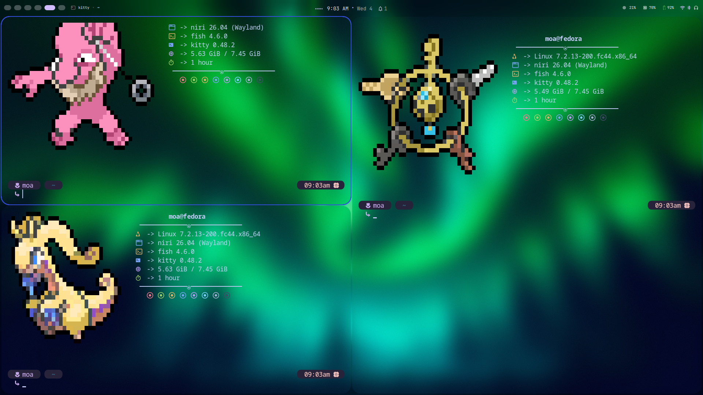

# niri config



[niri](https://github.com/YaLTeR/niri) + [DankMaterialShell](https://danklinux.com/)

## Install (Fedora)

```bash
# Enable DMS copr
sudo dnf copr enable avengemedia/dms

# Install
sudo dnf install niri dms

# Auto start with niri
systemctl --user add-wants niri.service dms
```

Copy this config to `~/.config/niri/`

```bash
git clone <repo> ~/.config/niri
```

## Delete (Fedora)

```bash
# Remove packages
sudo dnf remove dms niri

# Disable service
systemctl --user disable --now dms

# Clean up
rm -rf ~/.config/quickshell/dms ~/.config/DankMaterialShell ~/.local/state/DankMaterialShell ~/.cache/DankMaterialShell
rm -rf ~/.config/niri
```

## Cheat Sheet

### Apps
| Key | Action |
| --- | --- |
| `Super+Return` | kitty |
| `Super+D` | rofi |
| `Super+T` | alacritty |

### Windows
| Key | Action |
| --- | --- |
| `Super+Q` | Close |
| `Super+F` | Maximize |
| `Super+Shift+F` | Fullscreen |
| `Super+V` | Toggle float |
| `Super+P` | Float/tiling |
| `Super+B`/`Super+N` | Consume/expel |
| `Super+Comma`/`Super+Period` | In/out of column |

### Focus
| Key | Action |
| --- | --- |
| `Super+H`/`Super+L` | Column left/right |
| `Super+U`/`Super+I` | Window down/up |
| `Super+J`/`Super+K` | Workspace down/up |

### Move
| Key | Action |
| --- | --- |
| `Super+Ctrl+H`/`L` | Move column |
| `Super+Ctrl+U`/`I` | Move window/workspace |
| `Super+Shift+H/J/K/L` | Move to monitor |

### Layout
| Key | Action |
| --- | --- |
| `Super+R` | Cycle width |
| `Super+W` | Tabbed column |
| `Super+C` | Center column |
| `Super+Minus`/`Plus` | Width |
| `Super+Shift+Minus`/`Plus` | Height |

### Misc
| Key | Action |
| --- | --- |
| `Super+O` | Overview |
| `Super+Shift+E` | Quit |
| `Super+S` | Screenshot |
| `Print`/`Alt+Print`/`Ctrl+Print` | Screenshot modes |
| `Super+Shift+Slash` | Hotkeys |
| `Super+Shift+P` | Monitors off |
| `XF86Audio*` | Volume |
| `XF86MonBrightness*` | Brightness |